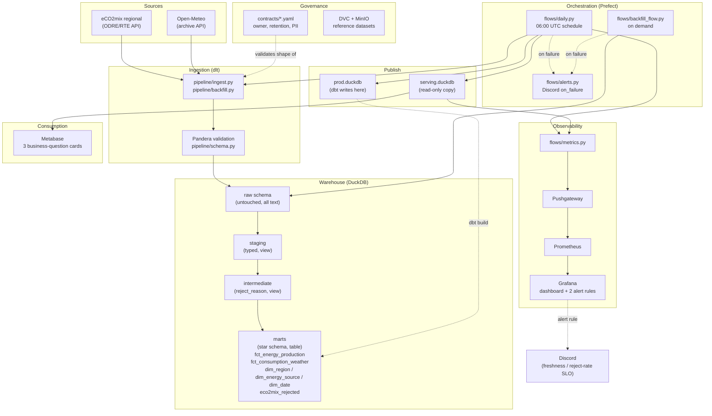

# Architecture

## Diagram

## Why these layers

- **ELT, not ETL**: raw data loads exactly as the source sent it
  (`raw` schema, every column as text); transformation happens in SQL
  inside the warehouse afterward. A wrong transformation rule can be
  fixed and replayed without re-fetching anything.
- **Medallion**: `raw` (bronze) → `staging`+`intermediate` (silver) →
  `marts` (gold). Each layer does one job: staging types columns and
  repairs nothing-is-lost issues; intermediate applies business rules
  and routes bad rows to quarantine; marts are what a dashboard reads.
- **Write-audit-publish**: dbt writes to `prod.duckdb`; dbt's own tests
  are the audit gate (the daily flow's `dbt_build_task` fails the whole
  run if any test fails); only on success does `publish_task` copy the
  result to `serving.duckdb`. Every downstream reader (Metabase, the
  metrics job) reads `serving.duckdb`, never the file dbt is actively
  writing to -- DuckDB only allows one read-write handle on a file at a
  time (CLAUDE.md section 7), so this is what keeps a dashboard query
  from ever blocking tomorrow's build.
- **Two independent alert paths** (ADR 0007): Prefect's own
  `on_failure` hook fires when a flow *run* crashes; Grafana's alert
  rules fire on the *published data's state* (stale, or too many
  rejects) -- a signal the orchestrator can't see on its own, e.g. the
  whole `worker` container not running at all.

## Where to find more detail

Every non-obvious decision behind this diagram has its own ADR in
`docs/adr/` -- what was decided, why, and what was tried and rejected
first. `docs/learning_log.md` has the step-by-step build history,
including every real bug found along the way (most of them found by
actually running something, not by reasoning about it in advance).
